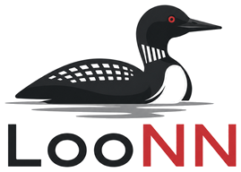

    

# Wingspan AI
This project contains LooNN, a neural network based bot capable of playing the board game Wingspan.

> ⚠️ **Disclaimer:** This project is an unofficial and independent AI implementation that is not affiliated with, 
endorsed by, or connected to Stonemaier Games, or any official creators or publishers of Wingspan.

## Usage

### Play in your browser

[Run LooNN](https://chasehbehrens.github.io/LooNN-Wingspan-AI/)

### Play in the terminal
Download the **[latest release](https://github.com/ChaseHBehrens/LooNN-Wingspan-AI/releases/latest)** for Linux, Windows, or macOS

On Linux or macOS, make the download executable with `chmod +x loonn-terminal-*`

On macOS, if it gets blocked, also run `xattr -d com.apple.quarantine loonn-terminal-*`

## About

Wingspan is an engine building game where players draft cards to add to the power of base actions. 
There are several aspects of the game that make it an interesting problem.
- a large number of choices per turn with few options per choice. 
- 180 unique bird cards, 27 bonus cards, and 16 end of round goals
- hidden information in the bird deck
- choices between multiple random outcomes
- combinatorial explosion of bird power combinations
- very little player interaction

LooNN uses a neural network evaluator trained with self play reinforcement learning. 
The evaluator predicts the remaining points scored in a game. 
Decisions are made by simply enumerating all possible options and picking the one with the highest predicted final score.
The player state is converted to a vector input containing all relevant information normalized to a range between 0 and 1. 
The player hand is input using an attention block that is then fed to the rest of the network. 

Claude Opus 5.5 was used to generate code in X areas of the project
- All user interface code
- Implementation of my plan for the neural network
- Network training scripts

## Performance
I trained the network in four player self play games for 182 hours. It trained from approximately 560,000 games.
Its averages 68.6 points per game with a standard deviation of 10.8 points. 
For reference this about the same level as me, someone who has played a couple of games and is not particularly good. 
While this network is not capable of superhuman performance, I am very happy with the results given the complexity of the game. 

## Limitations
This implementation resolves all powers triggered between turns at the start of a players turn for simplicity. 
LooNN is also not able to trade two for one resources. 
LooNN has no knowledge of end of round goal and bonus powers only the score they produce. 
LooNN is unable to skip running a power so if a card says discard a card to gain a food it will always run. 
There is also no adversarial capabilities as LooNN evaluates positions only based on its own board state. 
This implementation does not include any search which I suspect greatly hinders its performance.

## Improvements
This is version 0 and therefore there are many improvements and restructuring I would put into a later version.
For one all missing rules discussed in limitations could be implemented. 
A complete rewrite of the program would be needed to fix most of the issues.
Static strings are used in a lot of places where an enum would probably be better. 
The player would benefit from a state machine type structure instead of just one main function for playing a turn.
This would enable a better method for between turn actions than the current trigger system. 
Ultimately, the board needs to be represented in a way that is more conducive to search.

I represented powers as a single struct with fields for each type of power. 
I did it this way because I thought it would make it easier to vectorize. 
However, this is the wrong approach a bird should have a list of powers. 
Furthermore powers activation should be split into a different fn for each basic power. 
This would greatly simplify the play turn functions in player which quickly became overly long.
Then each basic power could have its own file in a mod that modifies the player. 

The board structure for powers should be abstracted further. 
Currently the power for each position is encoded separately this means the network will 
need to learn each powers value for each space. 
I believe representing the board as graphs of basic powers would be a much better approach. 

